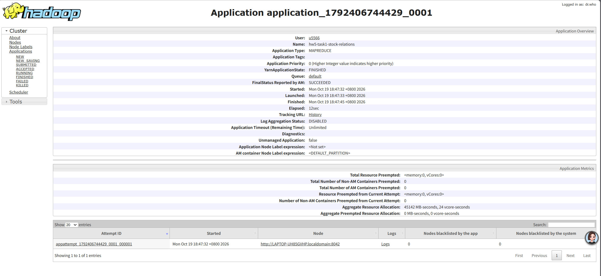
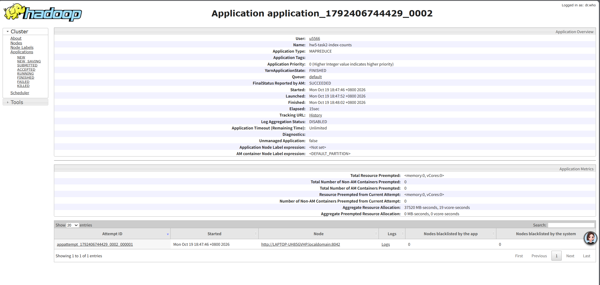

# 作业 5：股票集合关系与统计

姓名：王竞成　学号：241275017

## 1. 环境与运行状态

Windows / WSL2 Ubuntu 26.04，OpenJDK 11.0.32.1，Hadoop 3.3.6 单机伪分布式环境。
2026-10-19 已编译并在 HDFS + YARN 上完成两个 MapReduce 作业，均为 FINISHED / SUCCEEDED。
实际输出已与独立 Python 集合算法逐行核对，校验内容包括关系标签、统计数值和排序。

## 2. 输入与任务

[input/A.txt](input/A.txt) 包含 285 条记录，[input/B.txt](input/B.txt) 包含 320 条记录。
每行两列：指数编号和股票代码，以空格或制表符分隔。股票代码保留原始文本；同一股票在不同指数下分别计算。

任务一输出“指数编号、股票代码、关系标记”，标记为 BOTH、A_ONLY 或 B_ONLY。同一指数内重复记录只计算一次。
任务二直接读取任务一的输出，统计每个指数的交集、A 独有、B 独有和并集数量。

## 3. MapReduce 设计

### 任务一：集合关系

使用 MultipleInputs 为 A、B 指定不同 Mapper，键为自定义 StockKey（指数编号、股票代码），值为来源位标记 A=1、B=2。
Combiner 和 Reducer 对来源做按位或：1 对应 A_ONLY，2 对应 B_ONLY，3 对应 BOTH。
按位或满足结合律、交换律和幂等性，因此无论 Combiner 是否执行，重复记录都不会增加最终计数。
StockKey 按指数数值、股票代码字典序比较；单 Reducer 保证完整输出全局有序。

### 任务二：数量统计

Mapper 读取任务一输出，以指数编号为键、关系标签为值。Reducer 分别累计三类标签数量，三者之和为并集。
仅在任务一成功后提交任务二。指数使用 IntWritable，配合单 Reducer 按数值升序输出。

## 4. 编译与运行

先确保 Java、HDFS 和 YARN 正常运行，在 Ubuntu 的项目目录中执行：

```bash
bash check-env.sh
bash build.sh
bash run.sh
```

默认 Hadoop 路径为 `~/hadoop-3.3.6`，可通过 HADOOP_HOME 覆盖。
编译脚本使用已有 Hadoop 依赖与 javac，无需额外下载 Maven 依赖；也提供 pom.xml 供 Maven 构建。
run.sh 自动上传输入、连续提交两个作业、下载结果并执行独立校验。每次使用新的 HDFS 输出路径，保留历史结果。

本次运行编号：`20261019-184727-6287`。
本次 HDFS 基础目录：`/user/u5566/homework5/20261019-184727-6287`。
输入位于其 input 目录，输出位于 output_task1 和 output_task2 目录。

## 5. 实际运行结果

| 任务 | Application ID | Map 数 | Reduce 数 | 输出记录数 | Web 状态 |
|---|---|---:|---:|---:|---|
| 股票关系 | application_1792406744429_0001 | 2 | 1 | 547 | FINISHED / SUCCEEDED |
| 指数统计 | application_1792406744429_0002 | 1 | 1 | 3 | FINISHED / SUCCEEDED |

任务一读取 605 条输入，归并为 547 个唯一的“指数、股票”键；任务二读取这 547 条关系并输出 3 条统计。

| 指数编号 | 交集 | A 独有 | B 独有 | 并集 |
|---|---:|---:|---:|---:|
|101|3|13|4|20|
|102|3|19|3|25|
|103|52|195|255|502|

真实输出文件：

- [任务一结果：547 行](output/output_task1/part-r-00000)
- [任务二结果：3 行](output/output_task2/part-r-00000)
- [实际作业日志](evidence/job.log)

重新校验命令：

```bash
python3 verify.py output/output_task1/part-r-00000 output/output_task2/part-r-00000
```

通过时输出 `VERIFY_OK: 547 relations and 3 index summaries`。

## 6. Web 成功截图

### 任务一

Web 页面显示应用 hw5-task1-stock-relations 的最终状态为 SUCCEEDED，Elapsed 为 12 秒。



### 任务二

Web 页面显示应用 hw5-task2-index-counts 的最终状态为 SUCCEEDED，Elapsed 为 15 秒。



## 7. 问题与解决

1. 启动时 NameNode 缺失，HDFS 客户端连接 localhost:9000 被拒绝。检查发现原配置指向 /tmp 下的 NameNode 元数据目录，且对应 current 目录与检查点不存在。停止服务、备份配置后，在用户目录 hadoop-storage 下创建新的独立存储目录，更新 NameNode、DataNode、SecondaryNameNode 路径，初始化新 HDFS 并重新上传输入。旧路径保留，新 HDFS 不包含旧数据。
2. YARN 未启动时，检查命令持续重试。启动 ResourceManager、NodeManager，并在检查脚本中加入超时限制。
3. javac 提示使用了过时 API，但编译成功。实际作业成功和结果校验确认本次 Hadoop 3.3.6 环境可运行；后续升级时应替换过时接口。

## 8. 性能与改进

单 Reducer 简化了本次小数据的全局排序，但数据量大时会成为瓶颈，可采用范围分区与全局排序。
任务二可改为计数向量并添加 Combiner，减少 Shuffle 数据。
本次输入在各自文件内没有重复键，任务一 Combiner 输入和输出均为 605 条，实际没有减少记录数；跨文件相同键由 Reducer 合并。
本次运行验证了给定输入的结果。重复记录的处理由幂等的合并逻辑保证，本次没有另外执行重复输入的集群测试。

## 9. 提交文件

src/ 为源码；target/ 只保留 JAR；input/ 为课程数据；output/ 为真实运行输出；screenshots/ 为成功截图；evidence/ 为实际日志。
同时包含 pom.xml、.gitignore、编译运行和校验脚本。

```bash
python3 package.py
```

打包前校验输出并检查 JAR、截图存在，生成 ZIP。可提交该 ZIP，或上传整个项目到 GitHub 后提交仓库链接。
